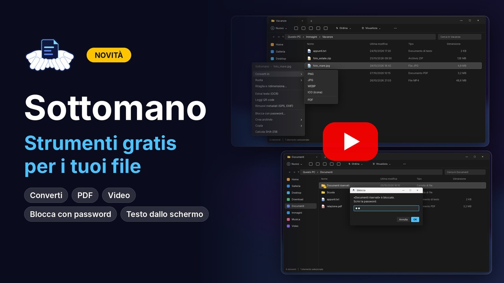

<p align="center"></p>

<h1 align="center">Sottomano</h1>

<p align="center"><b>Gli strumenti che ti servono sui file, a portata di mano.</b><br>
Per Windows 10 e 11 · gratis e open source · versione 0.2 (beta)</p>

<p align="center">
  <a href="https://www.youtube.com/watch?v=JA1--ifvx9c"></a><br>
  <sub>▶ Guarda il video su YouTube (1 minuto)</sub>
</p>

---

Sottomano aggiunge tre scorciatoie a Windows:

- **Ctrl+Alt+S → menu Strumenti.** Selezioni uno o più file, premi la combinazione e accanto al file si apre un menu, come quello del tasto destro, con le azioni adatte a quei file: conversioni, OCR, strumenti PDF, ritaglio, rinomina in blocco, archivi, taglio video e altro. Senza niente selezionato, il menu offre gli strumenti per la cartella aperta.
- **Spazio → anteprima al volo**, come QuickLook su Mac. Immagini, video con audio, PDF, testo e contenuto degli archivi si aprono all'istante; con le frecce scorri i file della cartella.
- **Ctrl+Alt+T → testo da una zona dello schermo**, in qualsiasi programma: trascini un rettangolo e Sottomano copia il testo che c'è dentro (e il contenuto dei QR code).

Inoltre:

- non modifica il registro di Windows;
- i risultati vengono salvati accanto all'originale, con un nome nuovo. Solo *Ruota* e *Rinomina* cambiano il file stesso, perché servono a quello;
- funziona tutto sul tuo PC: i file non vengono mai caricati da nessuna parte (vedi [Privacy](#privacy)).

> **Versione beta**: funziona, ma è giovane. Se trovi un problema apri una *Issue* allegando `errori.log` (vedi [Problemi](#problemi)).

## Cosa fa

Il menu mostra solo le voci adatte ai file selezionati.

| File selezionati | Azioni |
|---|---|
| **Immagini** (jpg, png, webp, bmp, gif, tiff, heic) | Converti in PNG / JPG / WEBP / ICO / PDF (più immagini = un solo PDF) · **Ruota** (i JPEG senza perdita di qualità) · **Ritaglia e ridimensiona** con editor grafico · Ridimensiona e comprimi più foto insieme · **Unisci** più foto in un'immagine (verticale, orizzontale, griglia) · Estrai testo (OCR) · Leggi QR code · Rimuovi metadati (GPS, fotocamera, data) · Copia l'immagine negli appunti · Rimuovi sfondo con AI *(opzionale)* |
| **PDF** | Copia testo · Estrai testo con OCR (per i PDF scansionati) · Unisci PDF · **Dividi o estrai pagine** · **Ruota, riordina ed elimina pagine** con le miniature · PDF in immagini · Comprimi PDF · Aggiungi o togli **password** |
| **Word, Excel, PowerPoint** (anche OpenDocument) | Converti in PDF (con Microsoft Office o LibreOffice, se installati) |
| **Video** (mp4, mkv, mov, avi, webm, wmv…) | Converti in MP4 / MKV / MOV / WEBM / GIF animata · **Taglia** (scegli inizio e fine guardando i fotogrammi) · Comprimi video · Estrai audio (MP3, WAV, M4A o traccia originale senza ricodifica) · Sottotitoli automatici `.srt` con AI *(opzionale)* |
| **Audio** (mp3, wav, m4a, flac, ogg…) | Converti in MP3 / WAV / M4A / FLAC · Taglia · Trascrizione in testo con AI *(opzionale)* |
| **Archivi** (zip, 7z, rar, tar, gz…) | **Estrai qui** (anche protetti da password) · Converti in 7z / ZIP / RAR |
| **Cartelle** | Trova duplicati · Crea archivio ZIP / 7z · **Blocca con password** |
| **Più file insieme** | **Rinomina in blocco** (nome e numero, data di scatto, sostituisci testo, con anteprima) |
| **Qualsiasi file** | **Blocca con password** · Crea archivio ZIP / 7z · Copia percorso · Calcola SHA-256 |
| **Niente selezionato** | Crea QR code · Trova duplicati nella cartella · Testo da una zona dello schermo |

- Il testo estratto viene copiato negli appunti e salvato in un `.txt` accanto all'originale. L'OCR riconosce italiano e inglese.
- Mentre un'azione lavora, accanto all'originale compare un file `nome.estensione.in-corso` (come i download di Chrome): quando sparisce, il risultato è pronto.
- **Editor di ritaglio**: trascini il riquadro con le maniglie e, quando lo rilasci, la vista si ingrandisce sulla zona scelta. Proporzioni fisse (1:1, 4:3, 16:9…), rotazione e dimensione finale con una barra.
- **Blocca con password**: il file o la cartella viene custodito, bloccato, nella cartella di Sottomano e al suo posto resta un **collegamento con lo stesso nome e la stessa icona**. Il doppio clic sul collegamento apre subito la finestra della password: nessuna finestra di Esplora file si apre prima.
  - **Sblocco parziale**: doppio clic sul collegamento (oppure **Spazio** per l'anteprima) → password → si apre l'elemento vero. Resta aperto finché lo usi: quando chiudi la cartella o il programma, Sottomano lo riblocca da solo.
  - **Sblocco completo**: Ctrl+Alt+S sul collegamento → *Sblocco completo* toglie la protezione per sempre e rimette l'elemento al suo posto, al posto del collegamento.
  - **Elementi bloccati…** (menu dell'icona vicino all'orologio): l'elenco di tutto ciò che è bloccato, per aprirlo, sbloccarlo o rimettere un collegamento cancellato per sbaglio. Cancellare il collegamento non cancella i dati.
  - Dove finisce l'elemento vero: `%LOCALAPPDATA%\Sottomano\bloccati` (per gli elementi su altri dischi, una cartella nascosta `.sottomano-bloccati` sullo stesso disco). Lo spostamento è istantaneo: cambia solo l'indirizzo, non si copia niente. Anche lì è bloccato dai permessi di Windows: non si apre, non si legge, non si sposta e non si elimina senza password.
  - Sottomano non salva la password, solo un'impronta per riconoscerla. Prima di disinstallare devi sbloccare tutto: la disinstallazione chiede la password di ogni elemento e rimette tutto al suo posto.
  - Da sapere: il collegamento ha la freccetta dei collegamenti di Windows (toglierla richiederebbe di modificare il registro). Una volta sbloccato, l'elemento si apre dalla sua posizione nella cartella di Sottomano. Se il desktop è sincronizzato con **OneDrive**, gli elementi bloccati non vengono più sincronizzati, perché non stanno più sul desktop.
  - Funziona con i permessi di Windows (NTFS), quindi sui dischi del PC ma non sulle chiavette FAT32/exFAT. È un blocco, non una cifratura: ferma chi usa il PC normalmente, ma un amministratore esperto di permessi di Windows può toglierlo. Per documenti davvero riservati usa un archivio cifrato (per esempio 7-Zip con password).
- **Trova duplicati** cerca anche nelle sottocartelle: file identici (stesso contenuto, anche con nomi diversi) e foto simili (la stessa foto ridimensionata o ricompressa). I file scelti vanno nel **Cestino**, quindi si possono recuperare.

## Scorciatoie

| Dove | Tasto | Cosa fa |
|---|---|---|
| Esplora file o desktop | **Ctrl+Alt+S** | apre il menu sui file selezionati (o sulla cartella, se non selezioni niente) |
| Esplora file o desktop | **Spazio** | anteprima del file selezionato (mentre rinomini o scrivi, lo Spazio resta uno spazio normale) |
| Anteprima | **← → ↑ ↓** | file precedente / successivo |
| Anteprima | **Invio** o doppio clic | apre il file nel programma predefinito |
| Anteprima | **Spazio**, **Esc** o clic fuori | chiude |
| Anteprima video | clic sul video · barra in basso | pausa · avanti e indietro |
| Esplora file o desktop | doppio clic o **Spazio** sul collegamento di un elemento bloccato | chiede la password, poi lo apre (con Spazio: l'anteprima) |
| Ovunque | **Ctrl+Alt+T** | testo (e QR code) da una zona dello schermo, copiato negli appunti |
| Editor di ritaglio | **rotellina** · **Invio** · **Esc** | zoom · salva · annulla |
| Pagine PDF | clic · **Ctrl**/**Maiusc**+clic · trascina · **Canc** | seleziona · più pagine · sposta · elimina |
| Taglia video | **← →** (con **Maiusc** più veloce) | sposta l'inizio o la fine di 0,1 s (1 s) |

## Installazione

Requisiti: Windows 10 o 11 con **winget** (già incluso nelle versioni recenti; altrimenti aggiorna "Programma di installazione app" dal Microsoft Store). Spazio su disco: circa 500 MB; in più circa 600 MB se scegli la rimozione sfondo con AI e circa 300 MB per i sottotitoli automatici.

### Con un comando (installa e aggiorna)

Apri **PowerShell** (Start → scrivi *PowerShell* → Invio) e incolla:

```powershell
irm erpelo.github.io/Sottomano | iex
```

Oppure dal **Prompt dei comandi** (Start → scrivi *cmd* → Invio):

```bat
cd /d %TEMP% && curl -L -o sottomano.zip https://github.com/ErPelo/Sottomano/archive/refs/heads/main.zip && tar -xf sottomano.zip && Sottomano-main\installa.bat
```

Entrambi scaricano l'ultima versione da questo repository e avviano `installa.bat`: lo stesso comando serve per installare e per aggiornare. Lo script che PowerShell esegue è [`docs/index.html`](docs/index.html) (è anche la pagina che vedi aprendo il link nel browser): poche righe, leggibili.

### A mano

1. Scarica il progetto: **Code → Download ZIP**, oppure dalla sezione *Releases*.
2. Estrai la cartella e fai doppio clic su **`installa.bat`**.
3. Fatto: seleziona un file e premi **Ctrl+Alt+S**, oppure **Spazio** per l'anteprima.

`installa.bat` fa due cose, e mostra ogni passaggio a schermo:

1. con **winget** (l'installer ufficiale di Windows) installa, solo se mancano, Python 3.12, 7-Zip e Tesseract OCR;
2. con `installa.py` installa le librerie Python (compreso FFmpeg per i video), scarica le lingue OCR italiano e inglese, crea il collegamento **Sottomano** nel menu Start e, **solo se lo scegli**, le funzioni AI facoltative, l'icona sul desktop e l'avvio automatico.

**Aggiornare da una versione precedente**: scarica la nuova versione e rilancia `installa.bat`. Chiude da solo la versione attiva e la sostituisce, e non rifà le domande: le funzioni AI, l'icona sul desktop e l'avvio automatico restano come li avevi scelti. Per rifare le domande, cancella `%LOCALAPPDATA%\Sottomano\scelte.txt` prima di rilanciare.

Sottomano resta attivo con un'icona vicino all'orologio (a volte tra le icone nascoste, sotto la freccia **^**). Per chiuderlo: tasto destro sull'icona → *Esci*. Per riaprirlo: menu Start → **Sottomano**.

**Perché è veloce**: Sottomano tiene pronto in anticipo un processo già avviato, fermo e senza usare CPU (circa 40 MB di RAM). Quando premi Spazio o scegli un'azione, la finestra si apre subito invece di dover prima avviare Python. Dopo ogni uso ne prepara un altro.

## Disinstallazione

Doppio clic su `disinstalla.bat` (si trova anche in `%LOCALAPPDATA%\Sottomano`). Se hai file o cartelle bloccati con password, prima te li fa sbloccare uno per uno e li rimette al loro posto: senza Sottomano non ci sarebbe più modo di aprirli. Se nella cartella `bloccati` restasse qualcosa, la disinstallazione si ferma e non cancella niente.

Durante l'installazione Sottomano tiene un registro (`installato.txt`) di **ciò che ha installato lui e che prima non c'era**: Python, 7-Zip, Tesseract, le librerie Python, i modelli AI, l'icona sul desktop. La disinstallazione mostra l'elenco, chiede conferma e rimuove **solo quelle cose**. Se avevi già Python, 7-Zip o una libreria prima di installare Sottomano, restano dove sono.

## Privacy

Tutte le operazioni avvengono sul tuo PC: Sottomano non carica i tuoi file su internet e non raccoglie dati. Si collega a internet solo durante l'installazione (per scaricare i programmi e le librerie dalle fonti ufficiali) e per scaricare i modelli AI facoltativi. OCR, QR code, sottotitoli e rimozione sfondo funzionano offline.

## Problemi

**L'antivirus lo blocca?** Sottomano è composto da script leggibili: puoi aprire ogni file con il Blocco note e controllare cosa fa. Alcuni antivirus segnalano per prudenza i programmi che restano attivi in background o ascoltano una combinazione di tasti. Se succede, puoi segnalare il falso positivo al produttore dell'antivirus (ad esempio [Kaspersky](https://opentip.kaspersky.com/)).

**Ctrl+Alt+S non fa niente?** Controlla che l'icona di Sottomano sia vicino all'orologio; se non c'è, avvialo dal menu Start. Se un altro programma usa già Ctrl+Alt+S, Sottomano te lo dice all'avvio. Se Ctrl+Alt+T è occupata, la zona dello schermo resta disponibile dal menu dell'icona.

**Converti in PDF dice che manca Office?** Serve Microsoft Office oppure [LibreOffice](https://it.libreoffice.org/) (gratis).

Gli errori vengono salvati in `%LOCALAPPDATA%\Sottomano\errori.log`: apri una *Issue* allegando il log.

## Dipendenze

Sottomano non include software di terzi: l'installer li scarica dalle fonti ufficiali.

| Progetto | Uso | Licenza |
|---|---|---|
| [Python](https://www.python.org/) | esecuzione | PSF |
| [Pillow](https://python-pillow.org/) | immagini | MIT-CMU |
| [pillow-heif](https://github.com/bigcat88/pillow_heif) | foto HEIC | BSD-3-Clause |
| [PyMuPDF](https://github.com/pymupdf/PyMuPDF) | PDF | AGPL-3.0 |
| [pypdfium2](https://github.com/pypdfium2-team/pypdfium2) (PDFium) | anteprime e miniature PDF | Apache-2.0 / BSD-3-Clause |
| [Tesseract OCR](https://github.com/tesseract-ocr/tesseract) + [tessdata_fast](https://github.com/tesseract-ocr/tessdata_fast) | OCR | Apache-2.0 |
| [pytesseract](https://github.com/madmaze/pytesseract) | OCR | Apache-2.0 |
| [pywin32](https://github.com/mhammond/pywin32) | menu, Esplora file, icona vicino all'orologio | PSF |
| [comtypes](https://github.com/enthought/comtypes) | icone dei file e posizione del menu | MIT |
| [ffpyplayer](https://github.com/matham/ffpyplayer) | anteprima video | LGPL-2.1 |
| [imageio-ffmpeg](https://github.com/imageio/imageio-ffmpeg) (include [FFmpeg](https://ffmpeg.org/)) | conversione video e audio | BSD-2-Clause (FFmpeg: GPL) |
| [7-Zip](https://www.7-zip.org/) | archivi | LGPL-2.1 |
| [qrcode](https://github.com/lincolnloop/python-qrcode) | creazione QR code | BSD |
| [zxing-cpp](https://github.com/zxing-cpp/zxing-cpp) | lettura QR code e codici a barre | Apache-2.0 |
| [rembg](https://github.com/danielgatis/rembg) *(opzionale)* | rimozione sfondo | MIT |
| [faster-whisper](https://github.com/SYSTRAN/faster-whisper) + modello [Whisper](https://github.com/openai/whisper) *(opzionale)* | sottotitoli e trascrizione | MIT |
| [Microsoft Office](https://www.office.com/) o [LibreOffice](https://www.libreoffice.org/) *(se già installati)* | Word/Excel/PowerPoint in PDF | proprietaria / MPL-2.0 |
| [WinRAR](https://www.win-rar.com/) *(opzionale, se già installato)* | creazione file .rar | proprietaria |

## Licenza

Copyright (C) 2026 Tommaso Pelosin

Distribuito con licenza **GNU AGPL-3.0**: vedi [LICENSE](LICENSE). Puoi usarlo, modificarlo e ridistribuirlo liberamente; le versioni modificate che distribuisci devono restare open source con la stessa licenza.

Il software è fornito **"così com'è", senza alcuna garanzia**. L'autore non è responsabile di eventuali danni o perdite di dati derivanti dal suo uso.
